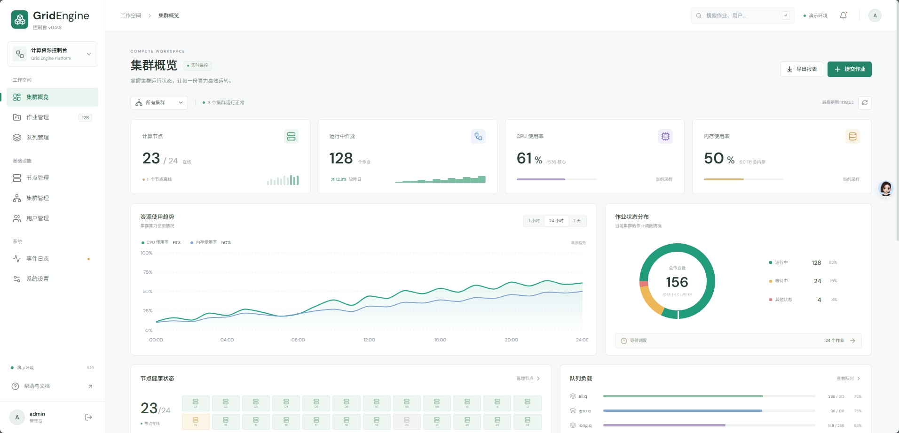
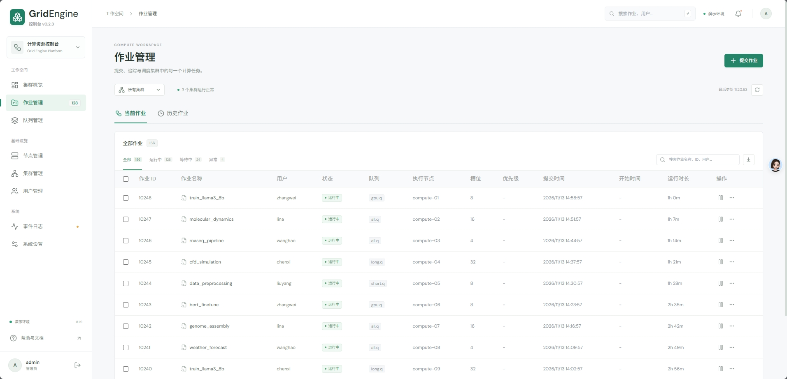
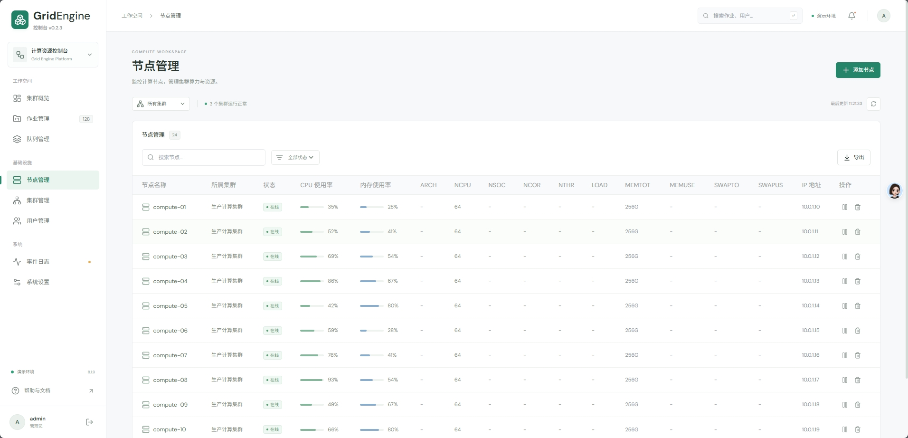

# GridEngine Console

[](#运行)
[](LICENSE)
[](https://github.com/xcai/gridengine-gui/watchers)
[](https://github.com/xcai/gridengine-gui/forks)
[](https://github.com/xcai/gridengine-gui/stargazers)

基于 Node.js、Express、React 和 Vite 的中文集群计算管理控制台，使用 pnpm 管理依赖。

## 系统界面截图







## 运行

需要 Node.js 22.12+ 和 pnpm。

```sh
pnpm install
pnpm admin:users create admin --role admin
pnpm dev:demo
```

开发模式同时启动 API 和前端。Vite 默认使用 5173，端口占用时自动选择下一个可用端口，以终端输出为准。API 默认使用 3101；设置 `API_PORT` 后，开发代理自动使用相同端口。

```sh
pnpm build:demo
pnpm start:demo
```

构建后由 Express 提供静态文件和 API，访问 `http://localhost:3101`。`pnpm preview` 仅预览前端产物，不会启动 API。

`dev:demo` / `dev:live`、`start:demo` / `start:live` 分别选择后端模式；`build:demo` / `build:live` 使用对应的 Vite mode 加载构建配置。未区分模式的 `dev`、`start`、`build` 命令仍保留，其中后端默认使用 demo 模式。

## Docker Compose

需要 Docker Engine 和 Docker Compose v2，无需在宿主机安装 Node.js 或 pnpm。Dockerfile 使用 Node.js 22、多阶段构建及锁文件安装依赖；生产前端由 Nginx 提供，`/api/` 转发到独立 Node 服务，API 不映射宿主机端口。

首次使用时，将环境变量模板复制为 `.env`，按需修改配置；Docker Compose 会自动读取：

```sh
cp .env.example .env
```

模板包含 `GRIDENGINE_MODE`、`DEV_PORT`、`WEB_PORT`、`NGINX_WORKER_PROCESSES` 和 `COOKIE_SECURE`，默认值与 Compose 配置一致。`NGINX_WORKER_PROCESSES` 可设为 `auto` 或正整数，用于配置 Nginx worker 进程数。`.env` 已忽略提交；命令行环境变量优先于 `.env` 中的值。

### 开发环境

```sh
docker compose --profile dev build dev
docker compose --profile dev run --rm --no-deps dev pnpm admin:users create admin --role admin
docker compose --profile dev up dev
```

访问 `http://localhost:5173`。源码挂载到容器，前端和后端支持热更新；依赖保存在独立卷中，启动时同步锁文件。修改依赖后重启 dev 服务；修改 Dockerfile 后重新构建。使用 `DEV_PORT=5174 docker compose --profile dev up dev` 可更换宿主机端口。

### 生产环境

```sh
docker compose --profile prod build
docker compose --profile prod run --rm --no-deps api pnpm admin:users create admin --role admin
docker compose --profile prod up -d
```

Nginx 在 `http://127.0.0.1:8080` 提供构建生成的 `dist`；发布新版时执行 `docker compose --profile prod up -d --build`。使用 `WEB_PORT` 可更换端口。默认仅绑定宿主机回环地址，应由宿主机 HTTPS 反向代理对外提供服务；生产默认启用 `COOKIE_SECURE=true`。仅本地 HTTP 验证时，用 `COOKIE_SECURE=false docker compose --profile prod up -d` 启动，否则浏览器无法在 HTTP 下使用登录 Cookie。此配置本身不终止 TLS。

开发和生产分别使用 `dev-data`、`prod-data` 命名卷保存 `/data/data.json` 和 `/data/auth.json`，账号相互独立；不会复制宿主机已有的账号或演示数据到镜像。按需备份卷并限制 Docker 管理权限。生产账号管理示例：

```sh
docker compose --profile prod exec api pnpm admin:users list
docker compose --profile prod exec api pnpm admin:users update admin --reset-password
docker compose --profile prod logs -f
docker compose --profile prod down
```

开发环境使用 `docker compose --profile dev down` 停止。`down` 保留数据，`down -v` 会删除对应命名卷中的数据，请谨慎操作。

容器默认运行 demo。Live 部署不能仅设置 `GRIDENGINE_MODE=live`：还需按目标集群扩展 Node 镜像，安装兼容的 SGE 客户端、挂载集群配置，并在 Compose 中显式传入 SGE 环境变量和配置集群可达的网络；详见下方 Live 说明。不要直接挂载与容器系统不兼容的宿主机二进制文件。

## 登录与账号管理

首次启动前执行 `pnpm admin:users create admin --role admin`，在终端交互输入并确认密码（输入不回显）。无默认账号或默认密码，密码长度为 12–128 个字符；账号以字母开头，长度 2–40，仅支持字母、数字、下划线和连字符。未初始化账号时，页面可打开，但不能登录或访问集群数据。

本机管理员通过以下脚本增删查改**控制台登录账号**：

```sh
pnpm admin:users create alice
pnpm admin:users list
pnpm admin:users get alice
pnpm admin:users update alice --reset-password
pnpm admin:users update alice --role admin
pnpm admin:users update alice --disabled true
pnpm admin:users update alice --disabled false
pnpm admin:users delete alice
```

`create` 默认创建 `user` 角色，交互设置密码；`update --reset-password` 交互重置密码。自动化可用 `--password-stdin` 从标准输入读取密码（末尾一个换行符会被移除），通过受控秘密管理工具提供输入，不要将密码放进命令行参数、仓库或 shell 历史。查询输出不含密码哈希。不能删除、停用或降级最后一个启用的管理员。

- `admin`：可读取状态和执行 demo 写操作；live 中仍只读。
- `user`：仅查看、查询和导出，不可修改集群资源；服务端和页面均限制写入。
- 登录账号独立于页面的集群用户，不创建或修改操作系统 / SGE 用户。原有集群用户的 `role` 不授予控制台权限。

账号默认存放在项目 `private/auth.json`（已忽略提交，文件权限 `0600`），可通过 `AUTH_FILE=/absolute/path/auth.json` 指定。脚本和后端必须使用相同的 `AUTH_FILE`，建议用同一个服务系统账号运行。脚本属于本机运维工具，不通过 Web 接口开放；有账号文件写权限的系统用户可以管理登录账号，须限制目录访问并备份账号文件。并发写入通过锁目录互斥、临时文件原子替换；若写进程异常退出，只能在确认无写进程后清理对应的 `.lock` 目录。

密码使用随机盐的 scrypt 哈希。会话 Cookie 为 HttpOnly、SameSite=Strict，最长 8 小时，退出立即失效；账号更新、密码重置、停用及删除均使该账号旧会话失效。会话仅存于单个后端进程内，重启后需要重新登录，不支持多副本共享会话。每个源 IP 在 15 分钟内最多连续尝试登录 10 次；成功后清除计数。默认不信任代理转发的客户端 IP，反向代理后限流可能按代理 IP 共享。

生产环境必须通过 HTTPS 提供服务，并设置 `COOKIE_SECURE=true` 以启用 Secure 和 `__Host-` Cookie。开发 HTTP 环境不要开启该选项。写请求要求 `Content-Type: application/json`，拒绝浏览器明确标记的跨站请求，不开放 CORS。仍建议部署在受信任网络，限制反向代理请求大小与频率。

## Demo 与 Live

`GRIDENGINE_MODE` 支持 `demo`（默认）和 `live`，其他值会在启动时报错。切换模式后须重启后端。

- `demo`：使用本地演示数据，保留原有创建、修改和删除功能。
- `live`：从当前 SGE 环境读取真实状态，不读写 `DATA_FILE`，不初始化演示数据。认证后的管理员资源写请求返回 `405`，普通账号写请求返回 `403`，前端同步禁用写操作；登录和退出不受只读限制。命令失败返回 `502`，不会回退到演示数据。

先将后端部署在能访问集群的 SGE 提交主机或管理主机上，以拥有查询权限的普通系统账户运行。加载该集群的环境，例如：

```sh
source /opt/sge/default/common/settings.sh
qstat -xml -u '*'
qhost -xml
qconf -sql
qconf -shgrpl

pnpm dev:live
```

请将环境脚本路径替换为实际路径。生产运行使用 `pnpm build:live` 后执行 `pnpm start:live`。进程继承当前 shell 的 `SGE_ROOT`、`SGE_CELL`、`PATH`、SGE 端口等环境变量；不会自动加载环境脚本或 `.env` 文件。通过 systemd 等运行时，应在服务中显式配置这些环境变量。

| 可选环境变量 | 默认值 | 用途 |
| --- | --- | --- |
| `SGE_BIN_DIR` | 从 `PATH` 查找 | `qstat`、`qacct`、`qhost`、`qconf` 所在目录，例如 `/opt/sge/bin/lx-amd64` |
| `SGE_CLUSTER_ID` | `sge` | 前端集群 ID |
| `SGE_CLUSTER_NAME` | `SGE_CELL` 或 `Grid Engine` | 前端集群名称 |
| `SGE_QMASTER_HOST` | `-` | 主控节点的展示名称，不改变命令连接目标 |
| `SGE_COMMAND_TIMEOUT_MS` | `10000` | 每条命令超时，范围 1–120000 毫秒 |
| `SGE_HISTORY_TIMEOUT_MS` | `120000` | 历史作业查询超时，范围 1–900000 毫秒 |
| `SGE_CACHE_MS` | `10000` | 成功快照缓存，范围 1–300000 毫秒 |

每个后端进程对应一套 SGE 环境，暂不支持多集群切换或 SSH 远程执行。命令使用参数数组，不执行 shell；除历史查询流式读取外，每条命令输出上限为 8 MiB，配置查询最多四条并发。并发状态请求合并，过期缓存查询失败会报错，不返回旧缓存作为新数据。

### Live 数据来源

| 数据 | 查询命令 |
| --- | --- |
| 所有用户的当前作业 | `qstat -xml -u '*'` |
| 历史作业 | `qacct -j -E -b 开始时间 -e 结束时间`（旧版不支持 `-E` 时回退到 `qacct -j`） |
| 作业完整详情 | `qstat -j 作业ID`（打开详情时查询） |
| 执行主机、负载、内存 | `qhost -xml` |
| 队列实例状态与槽位 | `qstat -f -xml -u '*'` |
| 队列配置 | `qconf -sql`、`qconf -sq 队列名` |
| 主机组 | `qconf -shgrpl`、`qconf -shgrp @组名` |
| 管理者用户、执行者用户、用户组 | `qconf -sm`、`qconf -so`、`qconf -sul` |

队列槽位从队列实例汇总；主机组保留原始成员（包括嵌套组引用），关联队列由队列 `hostlist` 的直接组引用反向计算，不展开嵌套关系。数组作业保留任务编号或范围。live 用户管理页分为管理者用户、执行者用户和用户组三个只读标签，分别展示对应 qconf 命令返回的名称；作业用户列表仍仅代表当前作业中观测到的用户。邮箱、部门和权限不推断。历史事件为空，不生成虚构审计记录。

作业表格显示调度优先级、执行节点、提交时间、开始时间和运行时长；SGE 未返回的字段显示 `-`，不会将开始时间当作提交时间。作业详情展示列表字段及 `qstat -j` 返回的完整原始信息；数组任务使用其作业 ID 查询，命令输出及可见字段取决于集群版本和查询权限。作业结束或查询失败时会显示错误。详情可能包含作业参数和环境信息，所有已认证账号均可查看，应限制账号访问。

历史作业来自 SGE accounting，按完成时间倒序显示，默认显示浏览器本地日期最近一个月的记录，可调整日期筛选；清除日期筛选后，无完成时间的记录排在末尾。需要 `qacct`、accounting 文件及相应读取权限；历史数量受集群保留策略约束。支持 `-E` 的版本按完成时间缩小查询范围；GE 6.2 等不支持该选项的版本回退到查询全部记录，服务端解析时按完成时间筛选，避免遗漏开始于筛选范围之前的作业。历史输出逐条解析，单条记录上限为 1 MiB，但查询结果仍会保存在服务端内存并发送给浏览器；旧版或数据量很大时可能需要增加 `SGE_HISTORY_TIMEOUT_MS`。查询失败会在历史页显示，不影响当前作业。demo 仅展示数据中实际存在的 completed/failed 记录，不生成模拟历史。

最近一次成功的历史查询在后端缓存 30 秒，相同日期范围可复用；历史页的刷新按钮会跳过缓存。旧版 `qacct` 首次查询仍需扫描完整 accounting 文件，耗时取决于文件大小和存储性能。

`qhost` 的平均负载不等于 CPU 使用率，因此 CPU 使用率显示 `-`，负载可在节点详情查看；内存百分比由 `mem_used / mem_total` 计算。未提供的主机 IP、引擎版本和指标显示 `-`；live 不显示模拟历史曲线和昨日对比。实际 SGE 发行版的命令参数和输出可能有差异，上线前需与目标集群核验。当前测试使用命令样例，不代表已完成真实集群联调。

## 功能

- 集群概览：计算节点、作业状态、CPU/内存使用情况、演示趋势图、节点健康矩阵及队列负载。
- 作业管理：脚本提交、用户和队列选择、槽位配置、搜索、状态筛选、分页、详情、挂起、恢复、终止及批量挂起。
- 用户管理：demo 支持创建、角色资料、启用、停用与删除并保护默认管理员；live 分标签查看管理者用户、执行者用户和用户组。
- 节点管理：添加节点、CPU/内存配置、资源使用率、详情、上下线与删除。
- 集群管理：创建、主控节点资料、详情、启停与关联资源删除保护。
- 队列管理：创建、槽位及优先级配置、负载、启停与活动作业删除保护。
- 队列组：在队列管理页管理 SGE 主机组（`@组名`），支持创建、编辑、成员节点与队列关联、搜索、集群筛选及删除。节点和队列必须属于同一集群；删除组前须解除队列关联，引用中的节点、队列及集群受删除保护。
- CSV 导出、操作事件、通知中心、集群筛选、自动刷新偏好以及移动端导航。

## 数据与边界

**默认 demo 模式不会连接或修改真实 Grid Engine 集群，也不会执行提交的脚本。** 首次运行生成 3 个集群、24 个节点和 156 个作业；更改保存到 `server/data.json`。通过 `DATA_FILE=/path/to/data.json` 可使用独立数据文件。趋势图和昨日对比为演示数据，不是历史监控采样。live 模式只执行上述查询，不允许提交或修改集群资源。

队列组按 SGE host group 建模，使用 `hosts` 保存节点 ID、`queueIds` 保存关联队列 ID；队列关联表示演示环境中的队列 `hostlist` 主机组引用，不执行 `qconf`。当前不支持嵌套主机组。已有数据文件会兼容加载，默认队列组为空，不修改原有资源。

集群用户的角色字段仅展示用户资料；控制台登录认证与服务端权限使用独立账号库。登录后可查看全部集群和作业信息，暂不支持按用户或集群隔离数据。两种模式仍建议部署在受信任网络，不要使用 root 运行。未来开放真实写操作前，还需审计持久化和受控写命令适配器。demo 中的集群启停与节点上下线仅修改演示状态，不代表操作系统关机。

## API

| 方法 | 路径 | 用途 |
| --- | --- | --- |
| POST | `/api/auth/login` | 账号密码登录：`username`、`password`；设置会话 Cookie |
| GET | `/api/auth/me` | 当前登录账号，不含密码信息 |
| POST | `/api/auth/logout` | 退出并撤销会话 |
| GET | `/api/state` | 集群、节点、队列、用户、作业与事件 |
| GET | `/api/jobs/history` | 已结束作业的 accounting 记录 |
| GET | `/api/jobs/:id/detail` | 作业详情：live 查询数字作业 ID，demo 返回作业记录 |
| POST | `/api/:resource` | 创建资源 |
| PATCH | `/api/:resource/:id` | 修改状态 |
| DELETE | `/api/:resource/:id` | 删除非作业资源 |
| POST | `/api/hostGroups` | 创建队列组：`name`、`cluster`、`hosts`、`queueIds` |
| PATCH | `/api/hostGroups/:id` | 完整更新队列组配置 |
| DELETE | `/api/hostGroups/:id` | 删除已解除队列关联的队列组 |

除登录和退出外，所有 API 均需会话 Cookie，未登录返回 `401`；资源写操作另需 `admin` 角色，否则返回 `403`。`resource` 为 `clusters`、`nodes`、`queues`、`users` 或 `jobs`。作业终止使用 PATCH，状态为 `deleted`；历史记录保留。接口使用 Zod 校验，错误以 JSON 返回。

上述写接口仅在 demo 中可用。`GET /api/state` 返回 `mode` 和 `readOnly` 字段；live 另返回 `fetchedAt`，表示命令快照生成时间。live 查询失败的响应也包含模式及只读标识。

## 验证

```sh
pnpm lint
pnpm build
pnpm test
```

`pnpm test` 不需要 SGE 或浏览器，覆盖账号脚本 CRUD、密码哈希、会话与权限、会话撤销、登录限流、请求格式保护、XML/配置解析、子进程命令调用、缓存、错误处理、live 写保护、文件隔离和 demo 持久化回归。集成测试使用临时账号、命令样例和数据目录，不修改实际集群或本地数据。

浏览器冒烟测试使用 demo：

```sh
pnpm exec playwright install chromium
GRIDENGINE_MODE=demo pnpm dev
```

另一个终端执行：

```sh
TEST_BASE_URL=http://localhost:5173 pnpm test:smoke
```

将测试 URL 改为实际 Vite 地址。测试在独立临时数据文件和 3109 端口启动 API，不修改演示数据。覆盖五类资源创建、状态变更、删除保护、持久化、作业交互、用户交互、CSV 下载及桌面/移动端布局。可用 `TEST_API_PORT` 调整测试端口，用 `PLAYWRIGHT_EXECUTABLE_PATH` 指定本机 Chromium。截图写入 `/tmp/gridengine-desktop.png` 与 `/tmp/gridengine-mobile.png`。
